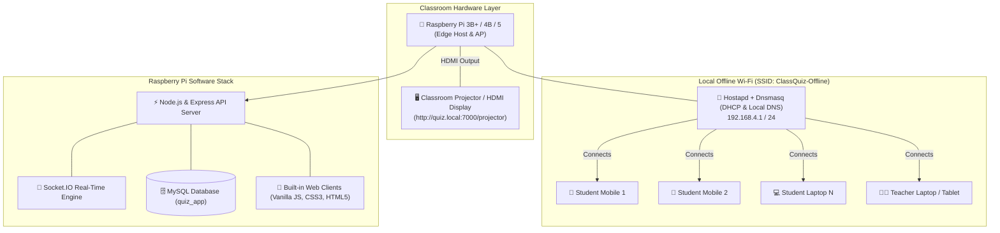

<div align="center">

# 🍓 Raspberry Pi Embedded Classroom Quiz System
### *An Edge-Hosted, Offline Interactive Quiz Platform for University Lecture Halls*

[](https://nodejs.org/)
[](https://expressjs.com/)
[](https://socket.io/)
[](https://www.mysql.com/)
[](https://www.raspberrypi.com/)
[](https://www.docker.com/)
[](https://opensource.org/licenses/MIT)

<p align="center">
  <b>No university internet connection required. Built to turn any lecture hall into an engaging, real-time evaluation environment.</b>
</p>

[System Architecture](#-system-architecture) •
[Features](#-key-features) •
[Web Interfaces](#-built-in-web-interfaces) •
[Quickstart](#-quickstart-guide) •
[Raspberry Pi AP Setup](#-raspberry-pi-hotspot-provisioning) •
[API Docs](#-api--websocket-reference)

---

</div>

## 📌 Project Overview

In university sessions and classrooms, reliable internet connectivity is often a major bottleneck. The **Embedded Quiz System** is a full-featured educational evaluation platform hosted locally on a **Raspberry Pi Wi-Fi Access Point**, enabling seamless offline examinations and evaluations.

The system connects two core platforms:

1. **👨‍🏫 Teacher Web Platform & Dashboard**:
   - Create, configure, and schedule course quizzes with timing modes and point values.
   - Bulk import and export quiz questions using standard CSV files.
   - Send instant notifications to student devices when a quiz is ready to be taken.
   - Comprehensive teacher evaluation dashboard: monitor attendance, class success rates, average grades, and inspect student score rosters and question-by-question analytics.
   - Manage academic levels, sections, groups, and student enrollments.

2. **🎓 Student Application & Dashboard**:
   - Receive real-time push and polling notifications when a new quiz is published.
   - Take assigned quizzes with countdown timers and instant answer recording.
   - Personal student dashboard: view academic profile (level, section, group), enrolled modules, and evaluation history.
   - Review past quizzes with complete question-by-question corrections and answer keys.

3. **🍓 Edge Hosting & Classroom Display**:
   - The entire platform runs on a standalone Raspberry Pi broadcasting its own local Wi-Fi hotspot (`ClassQuiz-Offline`).
   - Supports displaying the live quiz session and podium onto the classroom board via the Raspberry Pi HDMI output.

---

## 🏗️ System Architecture



---

## ✨ Key Features

- **📶 100% Offline Edge Architecture**: Zero external internet or cloud reliance. All requests, authentication, and data stay inside the classroom.
- **⚡ Sub-Millisecond WebSocket Sync**: Real-time Socket.IO synchronization for question broadcasts, active countdown timers, and answer submission receipts.
- **🖥️ Dedicated HDMI Projector Display**: High-contrast, large-format interface (`/projector`) designed to be crystal clear from 20+ meters away in large lecture halls.
- **👨‍🏫 Comprehensive Teacher Console**:
  - Live session orchestrator (broadcast question, trigger countdown, reveal answer, push leaderboard).
  - Bulk question import and export via CSV.
  - Student roster and group management.
- **📱 Responsive Mobile-First Student Portal**: Lightweight, touch-friendly UI (`/student`) with color-coded answer tiles and immediate receipt feedback.
- **📊 Real-Time Analytics & Grading**: Automatic weighted score calculations, response distribution percentages, and historical quiz archives.
- **🐳 Multi-Stage Docker Containerization**: One-command setup (`docker compose up`) for instant testing on any laptop or development workstation.

---

## 🎨 Built-In Web Interfaces

The application serves responsive, full-featured web applications directly from the Express server:

| Interface | Route | Purpose | Key Features |
| :--- | :--- | :--- | :--- |
| **Teacher Web Platform** | `/teacher` | Teacher orchestrator website & dashboard | Create quizzes, add questions, CSV import/export, push notifications to students, monitor student rosters, and view evaluation analytics & scores. |
| **Student Application** | `/student` | Dedicated student evaluation application | Receive real-time quiz notifications, take assigned quizzes with timer, submit answers, view enrolled modules, track scores, and review detailed corrections. |
| **Classroom Display** | `/projector` | Optional big-screen display for lecture hall board | Live session display with visual countdown timer, response count, and animated podium for classroom boards. |
| **Main Hub** | `/` | System landing portal and edge status | Quick access to Teacher Platform, Student App, and Board view with live network status. |

---

## 🚀 Quickstart Guide

### Option 1: 🐳 1-Command Docker Setup (Recommended)

Make sure [Docker Desktop](https://www.docker.com/) is installed and running, then:

```bash
# Clone the repository
git clone https://github.com/Imen-Chouat/embedded-quiz-system.git
cd embedded-quiz-system

# Start MySQL 8.0 and the Quiz Application
docker compose up -d
```

Once started, open your browser:
- **Landing Hub:** [http://localhost:7000](http://localhost:7000)
- **Classroom Projector:** [http://localhost:7000/projector](http://localhost:7000/projector)
- **Teacher Dashboard:** [http://localhost:7000/teacher](http://localhost:7000/teacher)
- **Student Portal:** [http://localhost:7000/student](http://localhost:7000/student)

---

### Option 2: 💻 Local Node.js Development

#### Prerequisites
- Node.js 20+ and npm
- Local MySQL Server (or Docker container for MySQL)

```bash
# 1. Install dependencies
npm install

# 2. Configure environment
cp .env.example .env
# Edit .env with your MySQL credentials

# 3. Run automated tests
npm test

# 4. Start the server
npm start
# Or for development with auto-reload:
npm run dev
```

---

## 🍓 Raspberry Pi Hotspot Provisioning

To configure a Raspberry Pi running Raspberry Pi OS (Debian/Bookworm) into an autonomous classroom Access Point with auto-starting quiz service:

```bash
# 1. Transfer code to Raspberry Pi
scp -r embedded-quiz-system pi@raspberrypi.local:/home/pi/

# 2. SSH into your Raspberry Pi
ssh pi@raspberrypi.local

# 3. Run the automated provisioning script as root
cd /home/pi/embedded-quiz-system
sudo bash scripts/rpi-access-point.sh
```

### What the Script Configures:
1. Installs `hostapd` and `dnsmasq`.
2. Assigns static IP `192.168.4.1/24` to `wlan0`.
3. Creates Wi-Fi Hotspot:
   - **SSID**: `ClassQuiz-Offline`
   - **Password**: `ClassQuiz2026`
4. Configures `dnsmasq` to assign DHCP IPs (`192.168.4.2` - `.100`) and map `quiz.local` to `192.168.4.1`.
5. Installs a `systemd` service (`embedded-quiz.service`) so the server starts automatically whenever the Pi is powered on.

---

## 📂 CSV Bulk Import Specifications

Teachers can bulk-load hundreds of questions into a quiz in seconds using standard CSV files:

### Question Import CSV (`examples/sample_quiz_questions.csv`):
```csv
question,option1,option2,option3,option4,correct
What is the primary function of an OS Kernel?,Manage hardware resources,Render 3D graphics,Compile source code,Power USB devices,1
Which scheduling algorithm may lead to starvation?,Shortest Job Next (SJN),Round Robin (RR),First-Come First-Served,Earliest Deadline First,1
```

### Student Roster CSV (`examples/sample_students_roster.csv`):
```csv
level,section,group,email
L3 Computer Science,Section A,Group 1,ada.lovelace@uni.edu
L3 Computer Science,Section A,Group 1,alan.turing@uni.edu
```

---

## 🔌 API & WebSocket Reference

### Core REST Endpoints

| Method | Endpoint | Description | Auth |
| :--- | :--- | :--- | :--- |
| `GET` | `/health` | System health, memory, and uptime | Public |
| `POST`| `/api/teachers/register` | Register new professor account | Public |
| `POST`| `/api/teachers/login` | Teacher authentication (returns JWT) | Public |
| `POST`| `/api/quizzes/create` | Create a new quiz session | Teacher Bearer JWT |
| `POST`| `/api/quizzes/importQuiz` | Bulk import questions from CSV | Teacher Bearer JWT |
| `POST`| `/api/quizzes/ExportQuiz` | Export quiz questions to CSV | Teacher Bearer JWT |
| `POST`| `/api/quizzes/start_teach`| Start quiz and trigger Socket broadcast | Teacher Bearer JWT |
| `GET` | `/api/result/quiz/:quizId/participants` | Retrieve quiz participant scores | Teacher Bearer JWT |
| `POST`| `/api/result/student/response` | Save student's answer choice | Student Bearer JWT |

### WebSocket Real-Time Events (Socket.IO)

| Event Name | Direction | Payload | Description |
| :--- | :--- | :--- | :--- |
| `quiz:join` | Client &rarr; Server | `{ quizId, role, name, email }` | Join the active quiz room |
| `quiz:participants_update`| Server &rarr; Room | `{ quizId, count, participants }` | Live updates of connected students |
| `quiz:broadcast_question` | Teacher &rarr; Server | `{ quizId, question, index, total }` | Pushes question to projector and students |
| `quiz:submit_answer` | Student &rarr; Server | `{ quizId, studentEmail, answerId }` | Records real-time student response |
| `quiz:submission_count` | Server &rarr; Room | `{ quizId, submittedCount, total }` | Live counter on projector and teacher console |
| `quiz:answer_revealed` | Teacher &rarr; Room | `{ quizId, correctIndex }` | Highlights correct answer on all screens |
| `quiz:finished` | Server &rarr; Room | `{ quizId, leaderboard }` | Reveals final evaluation podium |

---

## 🛠️ Tech Stack & Architecture Choices

- **Runtime & Framework**: [Node.js](https://nodejs.org/) & [Express 4](https://expressjs.com/) for lightweight, low-power execution on ARM-based single-board computers (Raspberry Pi).
- **Real-Time Communication**: [Socket.IO](https://socket.io/) for event-driven bi-directional communication between mobile devices, teacher console, and HDMI display.
- **Database Layer**: [MySQL 8.0](https://www.mysql.com/) with `mysql2/promise` connection pooling, normalized schema, and cascade constraints.
- **Security**: JWT (Access + Refresh tokens), bcryptjs password hashing, HTTP-only SameSite cookies.
- **Frontends**: Vanilla HTML5, CSS3 with responsive Grid/Flexbox, and native WebSocket client (zero frontend bundle overhead, ensuring instant loading on resource-constrained Pi hardware).

---

## 🧪 Testing

The test suite runs using Node.js's native test runner without third-party test bloat:

```bash
npm test
```

### Test Coverage Includes:
- Password hashing & verification with salt rounds.
- JWT token signing, verification, and tamper detection.
- Application health endpoint and uptime reporting.
- Public UI file serving (`/`, `/projector`, `/teacher`, `/student`).
- Route parameter validation and unauthorized access prevention.

---

## 👤 Author

**Imen Chouat**  
- Computer Science Student Project  
- GitHub: [@Imen-Chouat](https://github.com/Imen-Chouat)

## 📄 License

This project is licensed under the [MIT License](LICENSE).
